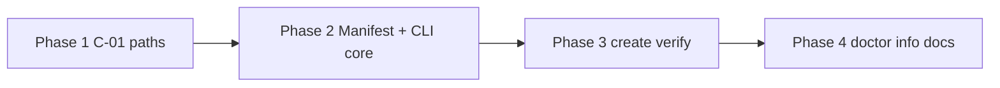

# Local CLI v0.1 — Audit & Implementation Plan

**Task:** TASK 1 — Portfolio Local CLI & Distribution Audit  
**Status:** Audit and planning only (no implementation)  
**Date:** 2026-11-25  
**Authoritative ADRs:** O-001, O-002, O-003 — unchanged by this document.

**Verified facts** are marked **(fact)**. **Recommendations** and **assumptions** are labeled explicitly.

---

## 1. Executive summary

**(fact)** The portfolio meta repository has four shared rules (`00`–`30`), six shared skills, a `project-template/` skeleton, ADRs, registry, and `portfolio/project-specs/`. O-001 mandates **COPY** from portfolio root as source of truth; the template currently ships only `99-project-local.mdc` and skill README stubs—not rules `00`–`30` or skill bodies **(fact)**.

**C-01 severity: HIGH.** Most distributed rules/skills reference `portfolio/*` paths, meta-repo ADRs, or portfolio-only workflows. Copied into a child repo under `projects/<name>` (or `--path`), agents cannot resolve those paths without adaptation or bundled reference docs.

**C-02 severity: HIGH.** Distribution is manual, error-prone, and duplicates intent (template README says “copy rules” but does not enforce or manifest it). No distribution manifest exists **(fact)**.

**Local CLI v0.1 (recommendation):** A Node.js CLI living inside the portfolio repo (local only, no npm publish) should implement `create`, `verify`, `doctor`, `info`, and `help`. It resolves portfolio root independently of cwd, copies template + rules + skills + **reference snapshots** (not live `portfolio/` tree), writes `.cursor/portfolio-distribution.json`, and never overwrites, deletes, runs `git init`, or installs packages.

**O-001 alignment note (recommendation):** O-001 states rules/skills arrive “via `project-template/`”. Implementation should treat **CLI + portfolio root `.cursor/`** as the mechanical source; template remains doc/layout skeleton. Propose a one-line consequence addendum to engineering-standards after approval—not an ADR rewrite.

---

## 2. Current repository structure (relevant)

**(fact)** Layout at audit time:

```text
portfolio-engineering-system/
├── .cursor/rules/          # 00, 10, 20, 30 (canonical shared rules)
├── .cursor/skills/         # 6 skills (canonical)
├── .gitignore              # /projects/ + legacy /portfolio/projects/
├── docs/decisions/         # O-001, O-002, O-003
├── docs/plans/             # this document
├── portfolio/
│   ├── engineering-standards.md
│   ├── design-principles.md
│   ├── portfolio-registry.md
│   └── project-specs/<id>/ # tracked per-project specs (not app source)
├── project-template/       # app skeleton; .cursor/rules/99 only
├── projects/               # gitignored; optional local app clones
└── README.md, CHANGELOG.md, LICENSE
```

**(fact)** Root `.gitignore` excludes `/projects/` (and legacy `/portfolio/projects/`).

**(fact)** No `package.json`, no CLI, no portfolio version manifest file at audit time.

---

## 3. C-01 findings — file by file

### Legend

| Class | Meaning |
|-------|---------|
| **PORTABLE** | Works in child repo after copy without portfolio paths |
| **NEEDS_ADAPTATION** | Contains portfolio-specific paths or assumptions |
| **PORTFOLIO_ONLY** | Should not be distributed; or only meta-repo sections apply |

### Rules

#### `00-portfolio-baseline.mdc`

| Class | **NEEDS_ADAPTATION** |
|-------|----------------------|
| Problem refs | L10 `portfolio-engineering-system`; L15 `portfolio/design-principles.md`; L32 `portfolio/portfolio-registry.md`, `portfolio/engineering-standards.md` |
| Why it fails | Child repo has no `portfolio/` directory |
| Recommended correction | (1) Copy snapshot → `docs/reference/portfolio-design-principles.md` at distribute time. (2) Retarget rule to `docs/reference/portfolio-design-principles.md` + optional `docs/reference/portfolio-context.md` (registry URL, link to meta repo). (3) Keep L10: “app repo unless task is meta” — **no behavior change**. |
| Behavior change? | **No** — same policy, portable paths |

#### `10-workflow-and-approval.mdc`

| Class | **NEEDS_ADAPTATION** |
|-------|----------------------|
| Problem refs | L8 `docs/decisions/O-003-task-classification.md` |
| Why it fails | O-003 lives in **meta** `docs/decisions/`; app template has different `docs/decisions/` (ADR format only) |
| Recommended correction | CLI copies O-003 → `docs/reference/O-003-task-classification.md` (read-only) OR `docs/decisions/portfolio-adopted/O-003-....md`; rule points to that path. Alternative: inline minimal summary in rule + “full text in docs/reference/”. |
| Behavior change? | **No** |

#### `20-ui-ux-system.mdc`

| Class | **NEEDS_ADAPTATION** |
|-------|----------------------|
| Problem refs | L11 `portfolio/design-principles.md` |
| Why it fails | Missing in app repo |
| Recommended correction | Same snapshot as C-01 `docs/reference/portfolio-design-principles.md`; rule L11 retarget. |
| Behavior change? | **No** |

#### `30-quality-gates.mdc`

| Class | **Mostly PORTABLE** + **PORTFOLIO_ONLY section** |
|-------|--------------------------------------------------|
| Problem refs | L34–36 “Portfolio meta repo” block |
| Why it fails | N/A in app — section irrelevant, not harmful |
| Recommended correction | Add frontmatter tag or comment: “§ Portfolio meta — skip in application repos.” Optional split `30-quality-gates-app.mdc` vs meta-only rule in future; v0.1 keep one file. |
| Behavior change? | **No** |

---

### Skills

#### `requirement-orchestrator`

| Class | **NEEDS_ADAPTATION** |
|-------|----------------------|
| Problem refs | L31 `portfolio/portfolio-registry.md`; L48 ADR O-003 path via rule |
| Recommended correction | Registry: use `docs/reference/portfolio-registry-entry.md` (CLI generates from args) or instruct “read remote registry in portfolio repo / user provides URL”. O-003 via copied reference doc. |
| Behavior change? | **No** |

#### `engineering-workflow`

| Class | **PORTABLE** |
|-------|--------------|
| Notes | Uses `docs/testing/`, `docs/decisions/` — exist in template |

#### `codebase-graph`

| Class | **NEEDS_ADAPTATION** (light) |
|-------|-------------------------------|
| Problem refs | L12–13, L37 `portfolio-engineering-system` as meta guard |
| Why it fails | Name-specific; still **works** as guard in app (negative path) |
| Recommended correction | Rephrase to “meta repository (no application source)” + detect via `.cursor/portfolio-distribution.json` `projectType: application` |
| Behavior change? | **No** (O-002 unchanged) |

#### `frontend-design`

| Class | **NEEDS_ADAPTATION** |
|-------|----------------------|
| Problem refs | L28 `portfolio/design-principles.md` |
| Recommended correction | → `docs/reference/portfolio-design-principles.md` |
| Behavior change? | **No** |

#### `portfolio-design-system`

| Class | **PORTFOLIO_ONLY** (default in app repos) |
|-------|---------------------------------------------|
| Problem refs | Entire skill targets `portfolio/design-principles.md`, `project-template/`, cross-app sync |
| Recommended correction | **Do not distribute** to app repos in v0.1 OR distribute with description “only when editing portfolio meta repo”. Apps use `frontend-design` + local `docs/design-system/`. |
| Behavior change? | **Clarification** — reduces noise in app skill list |

#### `quality-gate`

| Class | **NEEDS_ADAPTATION** (minor) |
|-------|-------------------------------|
| Problem refs | L18–19 portfolio doc consistency trigger |
| Recommended correction | Keep trigger; add “in application repo, skip portfolio meta checklist” |
| Behavior change? | **No** |

---

### C-01 summary table

| Asset | Classification |
|-------|----------------|
| 00, 10, 20 rules | NEEDS_ADAPTATION |
| 30 rule | PORTABLE + meta section |
| orchestrator, frontend-design | NEEDS_ADAPTATION |
| engineering-workflow | PORTABLE |
| codebase-graph | NEEDS_ADAPTATION (light) |
| portfolio-design-system | PORTFOLIO_ONLY |
| quality-gate | NEEDS_ADAPTATION (minor) |

**C-01 severity: HIGH** — blocks reliable child-repo Cursor behavior until reference bundle + path retarget (or dual-path wording) ships with CLI.

---

## 4. C-02 findings

**(fact)** `project-template/.cursor/rules/` contains only `99-project-local.mdc`.

**(fact)** `project-template/.cursor/skills/` contains only `README.md` (pointer to portfolio root).

**(fact)** Template includes: `.gitignore`, `docs/{product,architecture,design-system,decisions,testing,engineering}`, code-graph manifest.

| Gap | Severity |
|-----|----------|
| Missing rules 00–30 in template | HIGH — manual copy required |
| Missing 5 skill directories | HIGH |
| No distribution manifest | HIGH |
| Duplicate truth: template README vs O-001 vs actual files | MEDIUM |
| Template docs reference `portfolio-engineering-system/...` URLs | MEDIUM — OK as prose, not for agent paths |
| Bootstrap step “edit portfolio-registry” | MEDIUM — requires meta repo open |
| No `docs/reference/` for bundled portfolio snapshots | HIGH — needed for C-01 |
| `99-project-local.mdc` | CORRECT — project-specific, must not be overwritten |

**(fact)** No manually duplicated rule/skill **files** in template today — good; risk is **missing** copies, not stale duplicates.

**C-02 severity: HIGH.**

---

## 5. Proposed final `project-template/` structure

**(recommendation)** Template remains **skeleton only**. Shared rules/skills **never** stored as second copies in template git tree.

```text
project-template/
├── .gitignore
├── README.md                      # app placeholder; CLI overwrites sections
├── .cursor/
│   ├── portfolio-distribution.json  # GENERATED by CLI create (not in template source)
│   ├── code-graph-manifest.json
│   ├── rules/
│   │   └── 99-project-local.mdc   # only committed project-local rule stub
│   └── skills/                    # empty except .gitkeep or README “filled by CLI”
├── docs/
│   ├── reference/                 # NEW: CLI copies snapshots here
│   │   ├── portfolio-design-principles.md
│   │   ├── O-003-task-classification.md
│   │   └── portfolio-registry-entry.md   # GENERATED per project
│   ├── product/
│   ├── architecture/
│   ├── design-system/
│   ├── decisions/
│   ├── testing/
│   └── engineering/
│       └── gitignore.md
```

**Canonical source (fact + recommendation):**  
`portfolio-engineering-system/.cursor/rules/` and `.cursor/skills/` — CLI reads at runtime.

---

## 6. Proposed CLI architecture

### Placement **(recommendation)**

```text
portfolio-engineering-system/
├── cli/
│   ├── package.json          # "type": "module", engines node >=18
│   ├── bin/portfolio.js      # entry shebang
│   ├── lib/
│   │   ├── resolve-root.js
│   │   ├── create.js
│   │   ├── verify.js
│   │   ├── doctor.js
│   │   ├── manifest.js
│   │   ├── copy-tree.js
│   │   └── conflicts.js
│   └── README.md
└── .portfolio-root             # optional marker file (empty) for resolve-root
```

**Dependencies (recommendation):** Node built-in `fs`, `path`, `crypto` (sha256), `url`, `process`. Optional: zero npm deps v0.1.

### Portfolio root resolution **(recommendation)**

Order:

1. `--portfolio-root` flag or `PORTFOLIO_ROOT` env  
2. Walk from cwd upward: directory containing `.portfolio-root` OR (`portfolio/engineering-standards.md` + `.cursor/skills/requirement-orchestrator/SKILL.md`)  
3. If `cli/bin/portfolio.js` invoked: `path.resolve(__dirname, '../..')` when run from installed path inside repo  

Must work when terminal cwd is `projects/foo` or unrelated path.

---

## 7. CLI command specifications

### Global

```bash
node cli/bin/portfolio.js <command> [options]
# or after local npm link in portfolio only:
portfolio <command>
```

| Option | Description |
|--------|-------------|
| `--portfolio-root <path>` | Override portfolio root |
| `--json` | Machine-readable output |
| `--dry-run` | No writes |

### `create <project-name>`

| Option | Default | Description |
|--------|---------|-------------|
| `--path <dir>` | `{portfolioRoot}/projects/<project-name>` | Destination root |
| `--id <registry-id>` | slug of name | For registry entry stub |
| `--force` | off | **NOT in v0.1** — omit; never silent overwrite |

**Behavior:**

1. Resolve portfolio root  
2. Abort if destination exists and is non-empty **(recommendation)**  
3. Copy `project-template/**` → dest (files only; merge rules)  
4. Copy `.cursor/rules/{00,10,20,30}.mdc` → `dest/.cursor/rules/`  
5. Copy each `/.cursor/skills/*/SKILL.md` except optional skip `portfolio-design-system` **(recommendation)**  
6. Write adapted rules/skills OR post-process paths **(Phase 1)** — prefer source files with `docs/reference/` paths in repo after C-01 patch  
7. Copy `portfolio/design-principles.md` → `docs/reference/portfolio-design-principles.md`  
8. Copy `docs/decisions/O-003-*.md` → `docs/reference/`  
9. Generate `docs/reference/portfolio-registry-entry.md` stub  
10. Write `.cursor/portfolio-distribution.json`  
11. Print next steps: manual `git init`, registry edit in meta repo, open Cursor in **project** folder  

**Example:**

```bash
portfolio create noteai
portfolio create myapp --path D:/dev/myapp
portfolio create demo --dry-run
```

### `verify [project-path]`

Default `project-path`: cwd.

- Load `.cursor/portfolio-distribution.json`  
- Check required paths exist  
- Compare content hashes for **managed** files → report `MATCH | DRIFT | MISSING`  
- **DRIFT ≠ error** for non-protected files (local customization allowed)  
- **MISSING** on required files → exit code 1  

```bash
portfolio verify
portfolio verify ./projects/noteai --json
```

### `doctor`

- Portfolio root resolvable  
- Template dir present  
- Canonical rules/skills present  
- Node version >= 18  
- `/projects/` in portfolio `.gitignore`  
- Warn if `portfolio/projects/` legacy rule still present  

```bash
portfolio doctor
```

### `info`

- Portfolio path, git commit of portfolio (if `.git` exists), schema version  
- List distribution policy (O-001 copy, no sync v0.1)  

```bash
portfolio info
```

### `help`

Standard command list.

---

## 8. Manifest design

**Path:** `.cursor/portfolio-distribution.json` (in **application** project)

```json
{
  "schemaVersion": 1,
  "distributedAt": "2026-11-25T00:00:00.000Z",
  "portfolioRoot": "absolute-or-relative-note",
  "portfolioRevision": "git-sha-or-tag-or-unknown",
  "projectName": "noteai",
  "projectId": "noteai",
  "policy": {
    "mode": "copy",
    "autoSync": false,
    "o001": true
  },
  "bundles": [
    {
      "id": "shared-rules",
      "source": ".cursor/rules",
      "files": [
        {
          "source": "00-portfolio-baseline.mdc",
          "dest": ".cursor/rules/00-portfolio-baseline.mdc",
          "sha256": "...",
          "required": true
        }
      ]
    },
    {
      "id": "shared-skills",
      "source": ".cursor/skills",
      "files": []
    },
    {
      "id": "reference-docs",
      "files": [
        {
          "source": "portfolio/design-principles.md",
          "dest": "docs/reference/portfolio-design-principles.md",
          "sha256": "...",
          "required": true
        }
      ]
    }
  ],
  "protectedPaths": [
    ".cursor/rules/99-project-local.mdc",
    "docs/product/**",
    "docs/architecture/**",
    "docs/decisions/**",
    "docs/design-system/**",
    "docs/testing/**",
    "README.md"
  ],
  "managedPaths": [
    ".cursor/rules/00-portfolio-baseline.mdc",
    ".cursor/rules/10-workflow-and-approval.mdc",
    ".cursor/rules/20-ui-ux-system.mdc",
    ".cursor/rules/30-quality-gates.mdc",
    ".cursor/skills/**/SKILL.md"
  ]
}
```

**Drift handling (recommendation):**

| State | Meaning |
|-------|---------|
| `MATCH` | sha256 equals distribution record |
| `DRIFT` | File exists, hash differs — **allowed** unless `--strict` on verify (v0.2) |
| `MISSING` | Required managed file absent → **error** |
| `PROTECTED` | Never overwritten on create; verify never expects hash match for user-owned content |

Re-distribute / sync in v0.2+ must respect `protectedPaths` (O-001).

---

## 9. File conflict and safety strategy

| Rule | Implementation |
|------|----------------|
| No silent overwrite | `create` fails if any target file exists unless dest dir empty |
| No delete | CLI never `rm` user files |
| No `git init` | Not invoked |
| No npm/pip install | Not invoked |
| No app code generation | Template docs only |
| Empty dir creation | `mkdir -p` only inside new project root |
| Collision check | Pre-flight `readdir` + manifest of template files |

**(recommendation)** Exit codes: `0` ok, `1` usage/validation, `2` conflicts, `3` portfolio root not found.

---

## 10. Test plan

| # | Test | Type |
|---|------|------|
| T1 | `doctor` from random cwd | Manual |
| T2 | `create` → default `projects/test-cli-empty` | Manual |
| T3 | `create` same path twice → conflict exit 2 | Manual |
| T4 | `create --path` custom absolute path | Manual |
| T5 | `verify` fresh project → all MATCH | Manual |
| T6 | Edit `99-project-local.mdc` → verify DRIFT ok | Manual |
| T7 | Delete one rule → verify MISSING | Manual |
| T8 | Open project in Cursor; rules reference `docs/reference/*` | Manual |
| T9 | Portfolio `git status` does not show `projects/*` | Manual |
| T10 | `create` does not create `.git` | Manual |

Automated: Node test runner on `resolve-root`, `hash`, `conflicts` pure functions **(recommendation Phase 3)**.

---

## 11. Implementation phases and dependencies



| Phase | Depends on | Delivers |
|-------|------------|----------|
| **1** | Audit approval | Retargeted rules/skills + `docs/reference/` contract; **exclude** `portfolio-design-system` from app bundle decision |
| **2** | Phase 1 | `cli/lib/*`, manifest schema, `.portfolio-root` |
| **3** | Phase 2 | `create`, `verify` |
| **4** | Phase 3 | `doctor`, `info`, engineering-standards + README CLI section |

**No O-001/O-002/O-003 text changes** in Phase 1 except **non-ADR** engineering-standards bootstrap note **(needs approval)**.

---

## 12. Risks and unresolved decisions

| ID | Risk / decision | Status |
|----|-----------------|--------|
| R1 | Retarget rules in **canonical** portfolio `.cursor/` vs transform at copy-time | **Needs approval** — recommend edit canonical files to `docs/reference/` paths (single source) |
| R2 | Distribute `portfolio-design-system` skill to apps? | **Recommend NO** for v0.1 |
| R3 | Copy O-002 ADR to app `docs/reference/`? | **Recommend YES** for codebase-graph citations |
| R4 | O-001 “via project-template” wording | Document CLI as bootstrap mechanism |
| R5 | `portfolio create` inside gitignored `projects/` — user must `git init` inside child | **By design** |
| R6 | Path adaptation vs dual-path “if exists portfolio/…” | Dual-path fragile; prefer snapshots **(recommendation)** |
| R7 | Comma-separated rule globs — Cursor runtime | Untested **(fact from prior audit)** |

---

## 13. Files expected to change per phase

### Phase 1 — C-01 portability

- `.cursor/rules/00-portfolio-baseline.mdc`
- `.cursor/rules/10-workflow-and-approval.mdc`
- `.cursor/rules/20-ui-ux-system.mdc`
- `.cursor/rules/30-quality-gates.mdc` (optional meta § note)
- `.cursor/skills/requirement-orchestrator/SKILL.md`
- `.cursor/skills/frontend-design/SKILL.md`
- `.cursor/skills/codebase-graph/SKILL.md`
- `.cursor/skills/quality-gate/SKILL.md`
- `project-template/docs/reference/.gitkeep` or README stub
- `project-template/README.md` (bootstrap steps → CLI-first)
- `portfolio/engineering-standards.md` (reference bundle + CLI pointer)
- `CHANGELOG.md`
- **Not changed:** `docs/decisions/O-00*.md` ADR bodies

### Phase 2 — CLI foundation

- `cli/package.json`, `cli/bin/portfolio.js`, `cli/lib/*.js`, `cli/README.md`
- `.portfolio-root` (optional marker)
- `docs/plans/local-cli-v0.1-audit-and-plan.md` (status → implemented sections)
- Root `README.md`

### Phase 3 — create + verify

- Same as Phase 2 + tests if any

### Phase 4 — doctor, info, polish

- `portfolio/engineering-standards.md`, `project-template/.cursor/skills/README.md`

---

## Assumptions (explicit)

1. Node.js ≥ 18 available on dev machines running CLI.  
2. Child projects may be opened as sole Cursor workspace.  
3. Registry updates remain manual in meta repo for v0.1.  
4. No npm publish; invoke via `node cli/bin/portfolio.js`.  

---

## Approval checklist (before implementation)

- [ ] R1: Canonical rule path retarget vs copy-time transform  
- [ ] R2: Exclude `portfolio-design-system` from app distribution  
- [ ] R3: Bundle O-002/O-003 reference docs  
- [ ] Confirm `portfolio-design-system` remains in meta repo only  
- [ ] Approve manifest schema v1  
- [ ] Approve default `projects/<name>` under portfolio root  